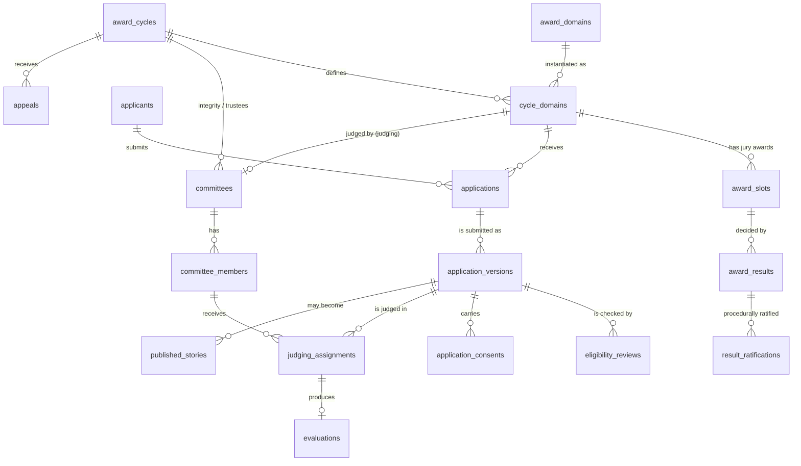
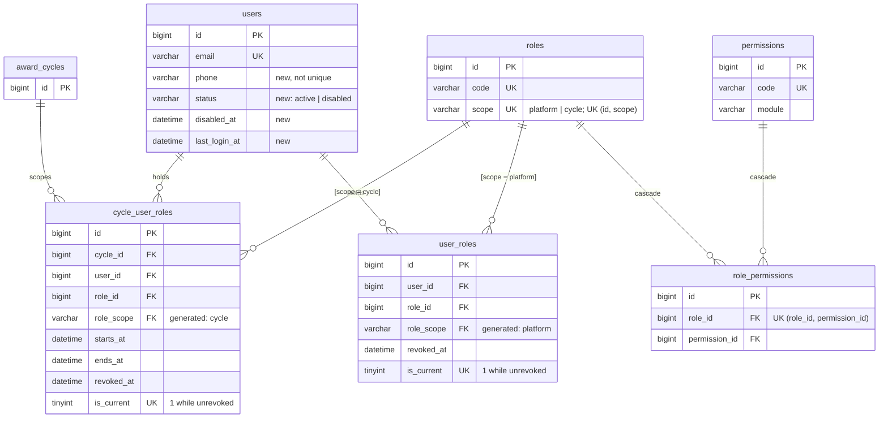
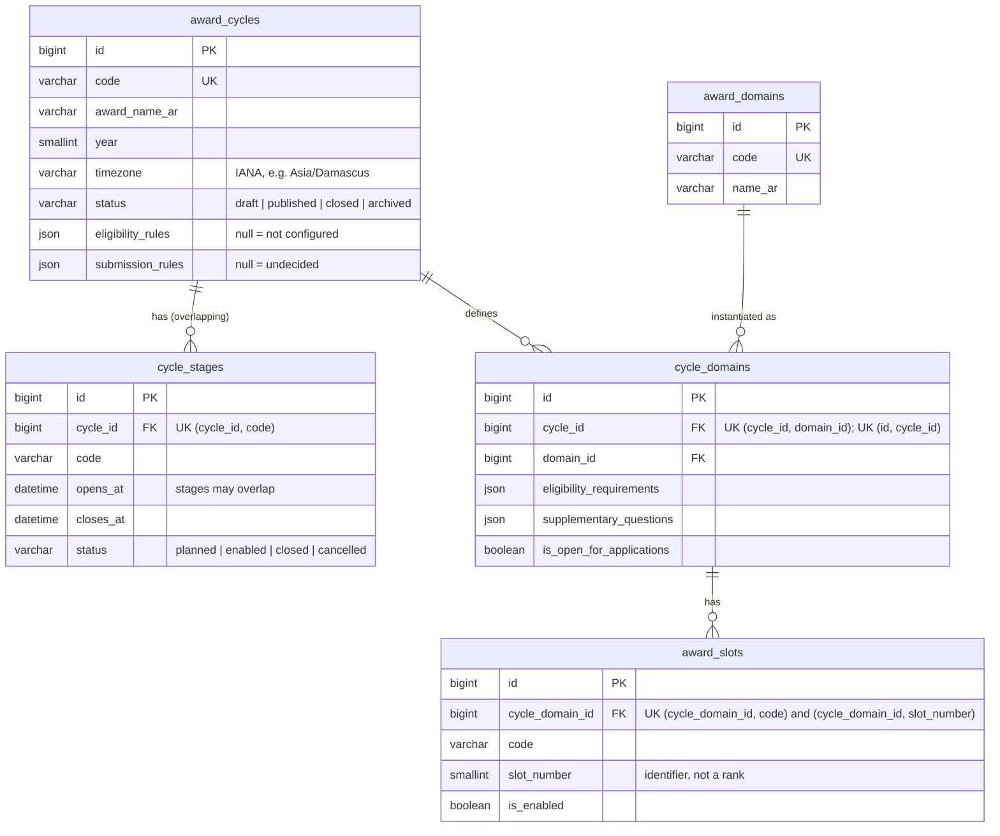
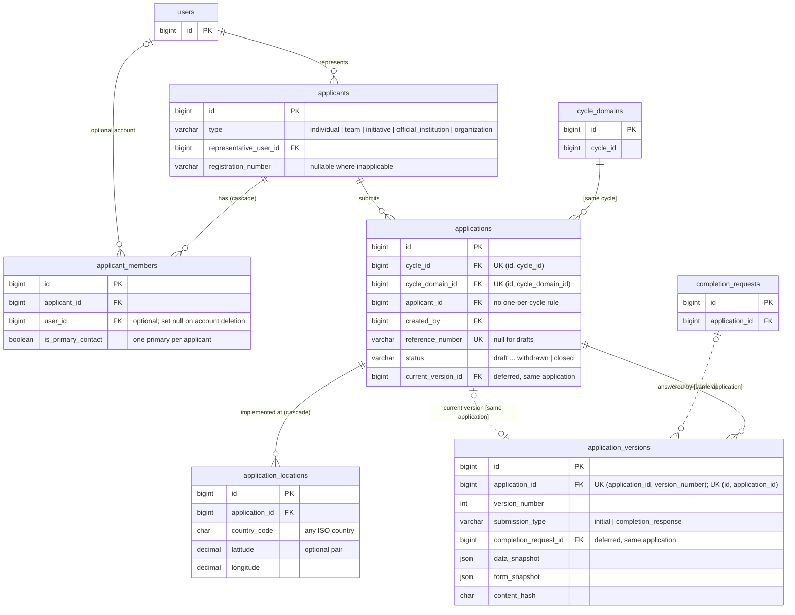
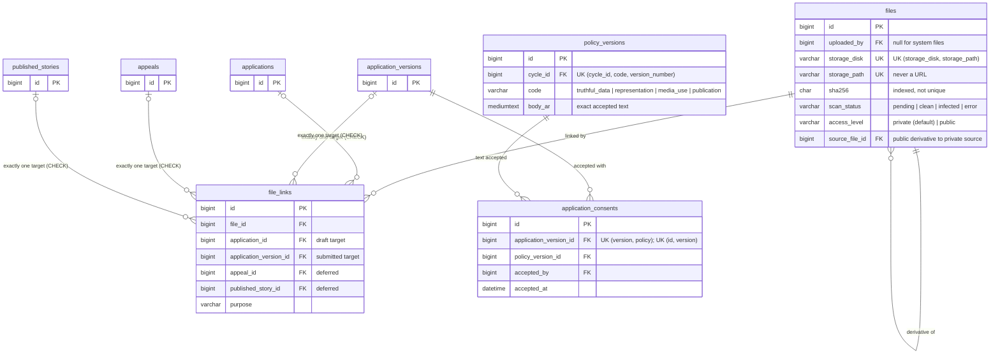
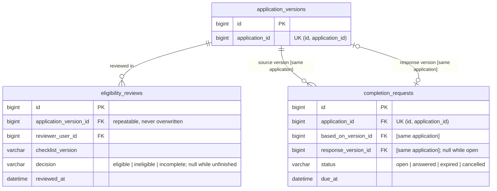
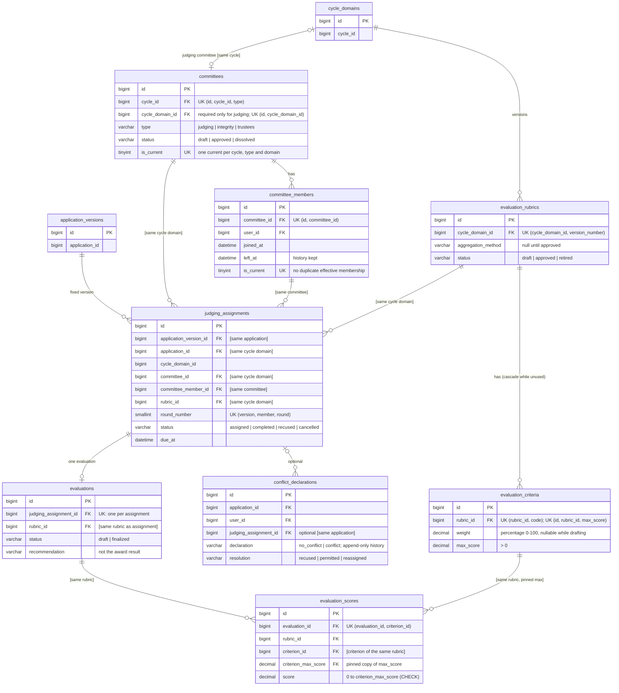
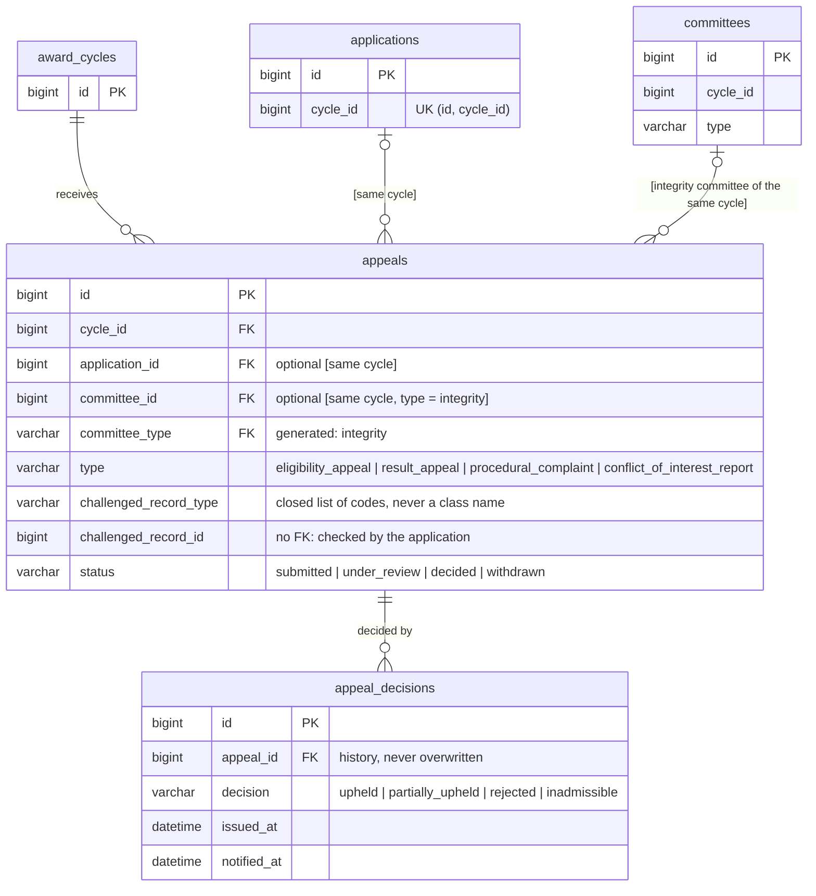
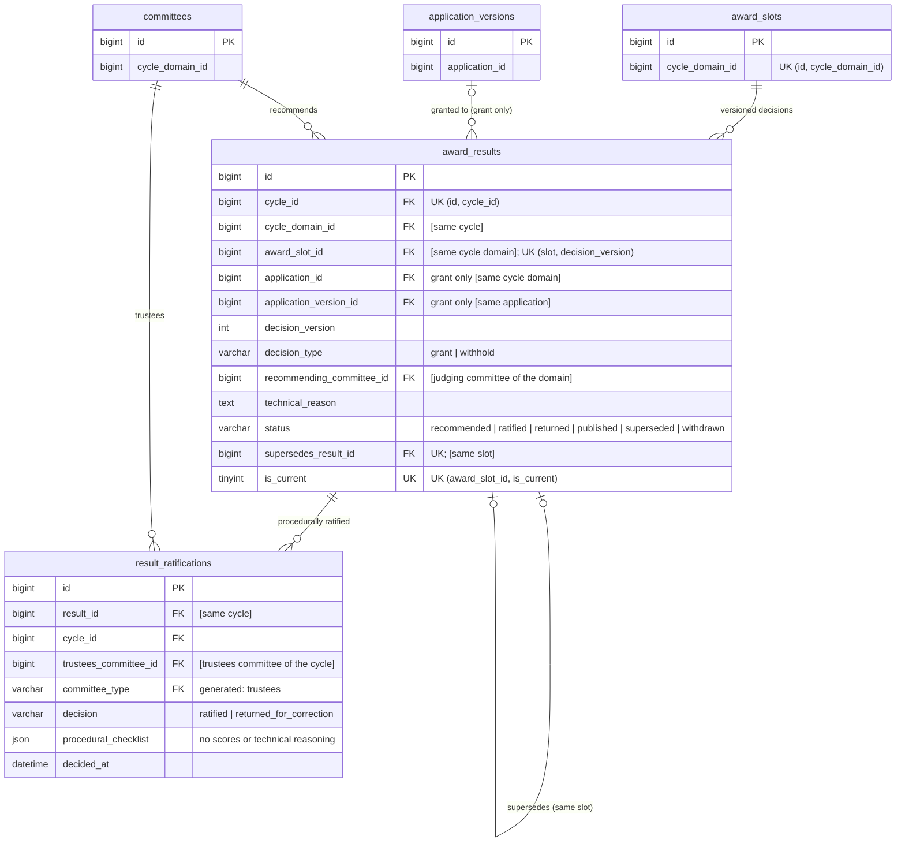
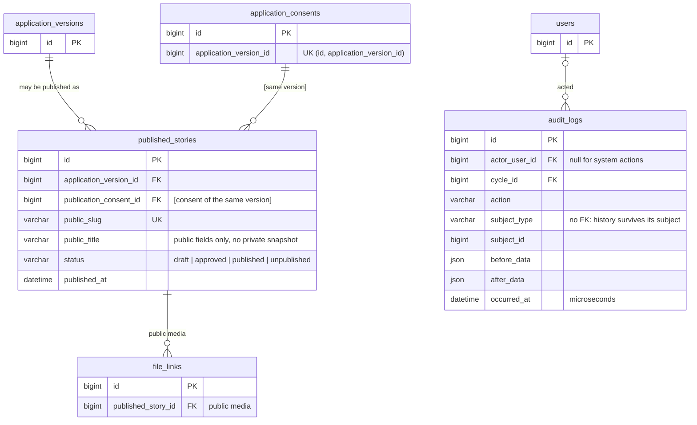

# Platform database: entity-relationship diagrams

These diagrams show the 36 tables of the platform database foundation, split by module.

- **Columns shown:** each diagram lists the keys and the columns that matter for relationships. Every field, type, index and constraint is in [database-schema.md](database-schema.md).
- **Rules:** the enforcement of each relationship is explained in [database-rules.md](database-rules.md).

**Notation**

- `PK` primary key, `FK` foreign key, `UK` part of a unique key.
- Relationship lines read parent → child: `||--o{` means "one parent, zero or more children".
- A label in brackets, such as `[same cycle]`, marks a **composite foreign key** that also enforces consistency. For example, `(cycle_domain_id, cycle_id) → cycle_domains (id, cycle_id)` makes the domain belong to the same cycle.

**Not modelled:** there is no voting, voter, audience-award, field-visit or field-verifier entity.

## Overview

How the modules connect. Lookup and audit relationships are left out for readability.

## A. Accounts and permissions

## B. Award cycles and domains

## C. Applicants and applications

The two dotted relationships are circular and are added by the last migration, `add_deferred_platform_foreign_keys`. A rollback removes them first.

## D. Files and consent

## E. Eligibility and completion

## F. Committees and judging

Every judging relationship is a composite key, so an assignment cannot mix applications, committees, members or rubrics from different cycle domains.

## G. Appeals

## H. Results and ratification

## I. Public stories and auditing

